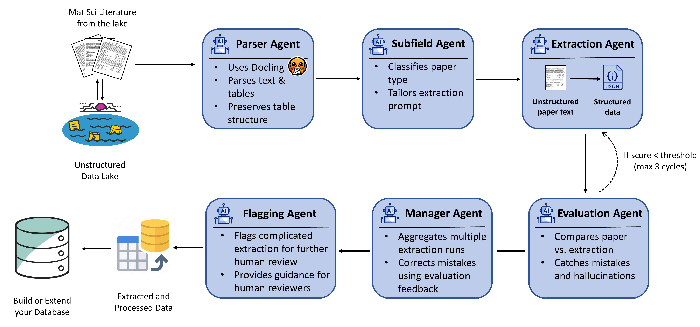

# KnowMat
### Agentic Materials Knowledge Extraction from Scientific Literature

[](https://doi.org/10.1007/s40192-026-00455-4)
[](LICENSE.txt)
[](https://www.python.org/)

Official implementation of the **KnowMat** framework described in:

> **KnowMat: An Agentic Pipeline for Materials Science Data Extraction from Scientific Literature**  
> Hasan Sayeed *et al.*  
> *Integrating Materials and Manufacturing Innovation* (2026)  
> https://doi.org/10.1007/s40192-026-00455-4

---



*Overview of the KnowMat multi-agent pipeline for converting scientific literature into structured, machine-readable materials data.*

---

## News

**July 2026:** 🎉 Our paper describing KnowMat has been published in *Integrating Materials and Manufacturing Innovation*.

**Repository:** https://github.com/hasan-sayeed/KnowMat2

**Paper:** https://doi.org/10.1007/s40192-026-00455-4

---

# Overview

Materials science knowledge is primarily communicated through unstructured scientific literature, making it difficult to build large, high-quality datasets for machine learning and materials informatics. While large language models have dramatically improved scientific information extraction, single-pass extraction approaches often suffer from incomplete coverage, inconsistent formatting, and hallucinated information.

**KnowMat** addresses these challenges through an **agentic extraction framework** that combines specialized LLM agents with iterative refinement, validation, and quality assurance. Rather than relying on a single prompt, KnowMat decomposes extraction into a coordinated workflow in which individual agents perform document parsing, subfield identification, structured extraction, evaluation, aggregation, hallucination correction, and final quality assessment.

The result is a reproducible pipeline that converts PDF research articles into structured JSON records containing material compositions, processing conditions, characterization methods, and measured properties that are suitable for database construction and downstream machine learning.

---

# Key Features

## 🤖 Multi-Agent Reasoning

KnowMat employs a LangGraph-based workflow in which specialized agents collaborate to improve extraction quality.

The pipeline includes:

- **Parser Agent** for high-fidelity PDF and table extraction using Docling
- **Subfield Detection Agent** that adapts prompts to experimental, computational, or machine learning papers
- **Extraction Agent** for structured materials knowledge extraction
- **Evaluation Agent** that critiques extraction quality and identifies missing information
- **Aggregation Manager** that combines multiple extraction runs
- **Validation Agent** that detects and removes hallucinated information
- **Flagging Agent** that identifies papers requiring human review

Unlike traditional one-shot extraction pipelines, KnowMat performs iterative extraction and validation before producing a final result.

---

## 📚 Comprehensive Materials Knowledge Extraction

KnowMat extracts a wide range of information commonly reported in materials science publications, including

- Material compositions and normalized chemical formulas
- Processing methods and synthesis conditions
- Heat treatments
- Mechanical processing
- Characterization techniques
- Processing atmospheres
- Material properties
- Units and numerical values
- Property ranges and inequalities
- Confidence estimates
- Supporting extraction metadata

The resulting JSON outputs are designed for direct ingestion into materials databases or machine learning workflows.

---

## 🛡️ Built for Scientific Reliability

KnowMat emphasizes trustworthy scientific data extraction through multiple layers of quality assurance.

Key capabilities include

- iterative extraction refinement
- confidence scoring
- hallucination detection
- rule-based aggregation
- LLM-based validation
- automatic property normalization
- human-review recommendations for uncertain extractions

This design substantially reduces the amount of manual post-processing required before extracted data can be used for scientific analysis.

---

# Pipeline Architecture

KnowMat consists of seven coordinated stages.

```
PDF
 │
 ▼
Docling Parser
 │
 ▼
Subfield Detection
 │
 ▼
Structured Extraction
 │
 ▼
Evaluation
 │
 ├──────────────┐
 ▼              │
Refinement ◄────┘
 │
 ▼
Aggregation
 │
 ▼
Validation
 │
 ▼
Flagging
 │
 ▼
Structured JSON Output
```

Each stage focuses on a narrowly defined task, allowing the overall system to achieve greater robustness than a single large prompt.

---

# Getting Started

## Prerequisites

Before installing KnowMat, ensure that you have

- Python 3.11
- Conda (recommended)
- An OpenAI API key
- (Optional) A LangSmith API key for tracing and debugging

---

## Installation

Clone the repository

```bash
git clone https://github.com/hasan-sayeed/KnowMat2.git
cd KnowMat2
```

Create the Conda environment

```bash
conda env create -f environment.yml
conda activate KnowMat
```

Configure your API keys by renaming `.env_example` to `.env`

```text
OPENAI_API_KEY=your_openai_api_key

LANGCHAIN_API_KEY=your_langsmith_key
LANGCHAIN_TRACING_V2=true
```

Alternatively, the keys may be supplied through environment variables.

---

# Quick Start

Process an entire directory of PDF papers with a single command.

```bash
python -m knowmat \
    --pdf-folder data/raw \
    --output-dir data/processed
```

KnowMat automatically

- parses each PDF
- extracts tables and text
- performs multiple extraction passes
- evaluates extraction quality
- merges the best results
- validates extracted information
- generates structured JSON output
- creates a human-readable analysis report

Each processed paper receives its own output directory containing structured data, intermediate extraction results, and summary reports.

---

# Why KnowMat?

Compared with conventional LLM extraction pipelines, KnowMat provides

| Traditional Extraction | KnowMat |
|-------------------------|----------|
| Single LLM prompt | Multi-agent workflow |
| One extraction pass | Iterative refinement |
| Minimal validation | Multi-stage validation |
| Hallucinations difficult to detect | Dedicated hallucination detection |
| Limited quality assessment | Confidence scoring and human review recommendations |
| Raw outputs | Standardized, ML-ready JSON |

The complete methodology, evaluation, and benchmarking are described in our publication:

> **KnowMat: An Agentic Pipeline for Materials Science Data Extraction from Scientific Literature**  
> *Integrating Materials and Manufacturing Innovation* (2026)  
> https://doi.org/10.1007/s40192-026-00455-4

# Using KnowMat

KnowMat can be used either from the command line for large-scale document processing or directly from Python for integration into custom workflows.

---

## Command-Line Interface

The simplest way to process a collection of research papers is

```bash
python -m knowmat \
    --pdf-folder path/to/pdfs \
    --output-dir output_directory
```

KnowMat automatically processes every PDF in the specified directory and creates a dedicated output folder for each paper.

---

## Advanced Usage

Individual agents can be configured independently, allowing users to balance extraction quality, runtime, and API cost.

```bash
python -m knowmat \
    --pdf-folder data/raw \
    --output-dir data/processed \
    --max-runs 3 \
    --subfield-model gpt-5-mini \
    --extraction-model gpt-5 \
    --evaluation-model gpt-5 \
    --manager-model gpt-5 \
    --flagging-model gpt-5-mini
```

---

## Command-Line Arguments

| Argument | Description | Default |
|-----------|-------------|---------|
| `--pdf-folder` | Directory containing PDF files | Required |
| `--output-dir` | Directory where results will be written | Required |
| `--max-runs` | Maximum extraction/evaluation iterations | `3` |
| `--subfield-model` | Model used for paper classification | `gpt-5-mini` |
| `--extraction-model` | Model used for structured extraction | `gpt-5` |
| `--evaluation-model` | Model used for extraction evaluation | `gpt-5` |
| `--manager-model` | Model used for validation | `gpt-5` |
| `--flagging-model` | Model used for final quality assessment | `gpt-5-mini` |

---

# Python API

KnowMat can also be incorporated directly into Python applications.

```python
from knowmat.orchestrator import run

result = run(
    pdf_path="paper.pdf",
    output_dir="data/processed",
    max_runs=3,
    subfield_model="gpt-5-mini",
    extraction_model="gpt-5",
    evaluation_model="gpt-5",
    manager_model="gpt-5",
    flagging_model="gpt-5-mini",
)

print(result["flag"])
print(result["confidence_score"])
```

The returned object contains the extracted data, confidence estimates, quality assessment, and metadata describing each stage of the extraction pipeline.

---

# Output Organization

Each processed paper receives its own directory containing both the final structured dataset and intermediate artifacts produced during processing.

```
data/
└── processed/
    └── Paper_Name/
        ├── Paper_Name_extraction.json
        ├── Paper_Name_analysis_report.txt
        ├── Paper_Name_runs.json
        └── docling_parse/
            ├── Paper_Name_final_output.md
            ├── table_html/
            └── table_images/
```

The directory structure is designed to support both automated downstream processing and human inspection of intermediate results.

---

# Output Files

## Structured Extraction

`Paper_Name_extraction.json`

Contains the final validated extraction after aggregation and quality control.

This file is intended for

- database construction
- materials informatics
- machine learning pipelines
- statistical analysis

---

## Analysis Report

`Paper_Name_analysis_report.txt`

Provides a concise human-readable summary including

- extracted compositions
- processing routes
- reported properties
- confidence assessment
- quality flags
- recommendations for manual review

---

## Extraction History

`Paper_Name_runs.json`

Stores every extraction attempt, evaluation result, confidence score, and intermediate decision made by the pipeline.

This file is particularly useful for debugging, benchmarking, and research on agentic workflows.

---

## Docling Outputs

The `docling_parse` directory contains

- parsed Markdown
- extracted tables
- HTML table renderings
- PNG images of tables

These artifacts allow users to inspect exactly what information was available to the extraction agents.

---

# JSON Schema

KnowMat produces machine-readable JSON designed for downstream analytics.

A simplified example is shown below.

```json
{
  "compositions": [
    {
      "composition": "Zr64.13Cu15.75Ni10.12Al10",

      "composition_normalized": "Zr64Cu16Ni10Al10",

      "processing_conditions": {
        "method": "melt spinning",
        "temperature": "1400 K",
        "atmosphere": "argon"
      },

      "characterization": {
        "XRD": "amorphous structure confirmed"
      },

      "properties_of_composition": [
        {
          "property_name": "glass transition temperature",
          "property_symbol": "Tg",
          "value_numeric": 625.0,
          "units": "K"
        }
      ]
    }
  ]
}
```

The complete schema supports

- normalized compositions
- processing conditions
- synthesis methods
- characterization techniques
- property symbols
- numerical values
- inequalities (`>`, `<`, `≥`, `≤`)
- value ranges
- qualitative properties
- confidence metadata

---

# Repository Structure

```
KnowMat2/
│
├── src/
│   └── knowmat/
│       ├── orchestrator.py
│       ├── nodes/
│       ├── extractors.py
│       ├── post_processing.py
│       ├── prompt_generator.py
│       └── states.py
│
├── configs/
│
├── data/
│   ├── raw/
│   └── processed/
│
├── notebooks/
│
├── tests/
│
├── docs/
│
├── environment.yml
├── pyproject.toml
└── README.md
```

The implementation follows a modular design in which each agent is implemented independently, making it straightforward to extend or replace individual components without modifying the remainder of the pipeline.

---

# Reproducing the Published Workflow

The default configuration reproduces the workflow described in the accompanying IMMI publication.

Unless you have a specific reason to modify the settings, we recommend using the default model assignments and three extraction/evaluation iterations reported in the paper.

For large-scale corpus processing, KnowMat supports batch execution across hundreds of papers with no changes to the workflow.

# Advanced Features

KnowMat was designed to move beyond single-pass LLM extraction by combining multiple specialized agents into a coordinated workflow. Each stage is responsible for a narrowly defined task, enabling the system to produce more complete and reliable structured datasets than conventional prompting approaches.

---

## Iterative Extraction

Rather than relying on a single extraction attempt, KnowMat performs multiple extraction–evaluation cycles.

After each extraction pass, an Evaluation Agent critiques the results, identifying

- missing compositions
- overlooked processing conditions
- missing properties
- formatting inconsistencies
- unsupported or hallucinated information

The feedback is incorporated into subsequent extraction attempts, allowing later iterations to recover information missed during earlier passes.

By default, KnowMat performs **three extraction/evaluation cycles**, although this can be adjusted using the `--max-runs` option.

---

## Two-Stage Aggregation and Validation

A distinguishing feature of KnowMat is the separation of aggregation from validation.

### Stage 1: Rule-Based Aggregation

The aggregation stage combines multiple extraction runs without requiring additional LLM calls.

The algorithm

- selects the highest-confidence extraction as the primary result
- merges additional compositions recovered in other iterations
- removes duplicate entries
- preserves provenance information

Because this stage is deterministic, it is both inexpensive and highly reproducible.

---

### Stage 2: LLM Validation

Once aggregation is complete, a dedicated Validation Agent performs a second review focused on scientific correctness.

The validator

- removes hallucinated properties
- resolves inconsistent formatting
- verifies numerical consistency
- checks placeholder responses
- standardizes output structure
- prepares the dataset for downstream machine learning applications

Separating aggregation from validation substantially improves both efficiency and reliability.

---

# Property Standardization

Materials properties are reported using a wide variety of names, abbreviations, and symbols.

For example,

| Literature | Standardized Output |
|------------|---------------------|
| Tg | Glass transition temperature |
| UTS | Tensile strength |
| Young's modulus | Elastic modulus |
| ZT | Thermoelectric figure of merit |

KnowMat automatically standardizes property names using an LLM-assisted post-processing stage, making datasets significantly easier to analyze across publications.

---

# Batch Processing

KnowMat is designed for literature-scale extraction.

A single command processes every PDF within a directory.

```bash
python -m knowmat \
    --pdf-folder data/raw \
    --output-dir data/processed
```

Typical output appears as

```
Processing paper 1 of 150...
Processing paper 2 of 150...
Processing paper 3 of 150...
...
```

After processing completes, KnowMat summarizes the run.

```
Total papers processed: 150

Successful: 147

Flagged for review: 18

Failed: 3

Total compositions extracted: 2,341
```

---

# LangSmith Integration

KnowMat optionally integrates with **LangSmith** to provide detailed tracing of every agent interaction.

When tracing is enabled, users can inspect

- prompts
- model responses
- confidence estimates
- evaluation feedback
- validation decisions
- execution timing
- token usage

Tracing is invaluable when developing new prompts or benchmarking extraction performance.

To enable tracing,

```text
LANGCHAIN_API_KEY=your_key
LANGCHAIN_TRACING_V2=true
```

---

# Model Configuration

Each agent can be assigned a different language model.

This enables users to optimize both runtime cost and extraction quality.

## Recommended Configuration

```text
Subfield Detection      GPT-5 mini

Extraction              GPT-5

Evaluation              GPT-5

Validation              GPT-5

Flagging                GPT-5 mini
```

This configuration matches the workflow described in the accompanying publication.

---

## Budget Configuration

For large-scale exploratory extraction, all agents may be assigned lightweight models.

```text
Subfield Detection      GPT-5 mini

Extraction              GPT-5 mini

Evaluation              GPT-5 mini

Validation              GPT-5 mini

Flagging                GPT-5 mini
```

This substantially reduces API cost while maintaining reasonable extraction performance.

---

# Troubleshooting

## OpenAI API Key Not Found

```
OPENAI_API_KEY not set
```

Verify that your `.env` file contains a valid OpenAI API key or that the environment variable has been exported before launching KnowMat.

---

## Docling Parsing Errors

Some PDFs contain malformed objects or unsupported formatting.

Possible solutions include

- re-downloading the PDF
- removing password protection
- verifying the document opens correctly in a PDF reader

---

## Property Standardization Errors

If property normalization fails, verify that the configuration files were installed correctly and that the property database is available.

---

# Citation

If KnowMat contributes to your research, please cite the accompanying publication.

```bibtex
@article{sayeed2026knowmat,
  title={KnowMat: An Agentic Pipeline for Materials Science Data Extraction from Scientific Literature},
  author={Sayeed, Hasan and others},
  journal={Integrating Materials and Manufacturing Innovation},
  year={2026},
  doi={10.1007/s40192-026-00455-4}
}
```

Repository:

https://github.com/hasan-sayeed/KnowMat2

---

# Contributing

Contributions are welcome.

Bug reports, feature requests, documentation improvements, and pull requests are all appreciated.

If you would like to contribute,

1. Fork the repository.
2. Create a feature branch.
3. Commit your changes.
4. Open a pull request.

Please see `CONTRIBUTING.md` for additional guidance.

---

# License

KnowMat is released under the **MIT License**.

See `LICENSE.txt` for complete licensing information.

---

# Acknowledgments

KnowMat builds upon several outstanding open-source projects, including

- LangGraph
- LangChain
- Docling
- PyScaffold

We gratefully acknowledge the developers and research communities behind these projects.

---

# Related Resources

**Paper**

KnowMat: *An Agentic Pipeline for Materials Science Data Extraction from Scientific Literature*

https://doi.org/10.1007/s40192-026-00455-4

**Source Code**

https://github.com/hasan-sayeed/KnowMat2

---

# Contact

Questions, bug reports, and feature requests are welcome through GitHub Issues.

For academic inquiries, please contact the corresponding author listed in the publication.

---

## Roadmap

Future development of KnowMat will focus on

- extraction of quantitative information from scientific figures
- direct integration with materials databases
- support for chemistry and broader scientific domains
- multimodal reasoning over text, tables, and figures
- additional open-weight LLM backends
- improved benchmarking across diverse materials subfields

---

If you use KnowMat in published work, we would appreciate a citation to the accompanying IMMI paper.
